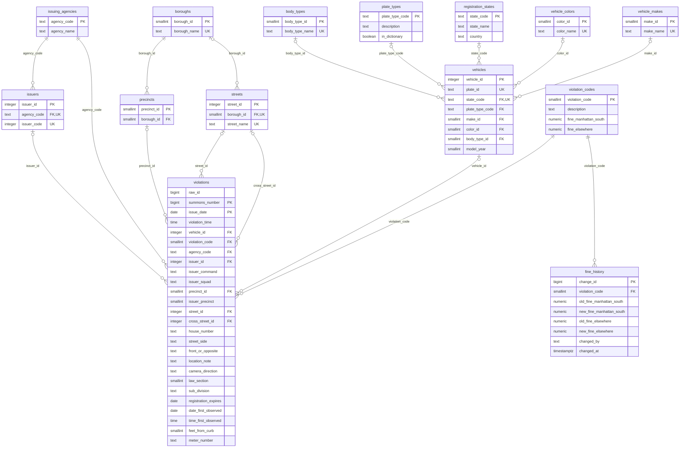

# curbside

I took one fiscal year of New York City parking tickets, 15.7 million rows of messy public CSV, and turned it into a clean PostgreSQL database with keys, constraints, indexes and checks that prove no row went missing.

Every number in this README was measured on my laptop, an HP OmniBook 5 (Intel Core 5 120U, 8 GB RAM, Windows 11) running PostgreSQL 16.15.

## The raw data

The source is the [Parking Violations Issued - Fiscal Year 2026](https://data.cityofnewyork.us/d/9mwx-gamw) dataset from NYC Open Data, plus the [DOF Parking Violation Codes](https://data.cityofnewyork.us/d/ncbg-6agr) list for the fines. The fiscal year runs from July 2025 to June 2026. The download is a 562 MB gzip file with 15,691,604 rows and 44 columns, and every column is text. These are real values from it:

| column | raw value | what it really is |
|---|---|---|
| summons_number | 9,230,983,706 | a number with commas in it |
| issue_date | 09/30/2025 12:00:00 AM | a date with a fake time |
| violation_time | 1025A | 10:25 in the morning |
| vehicle_expiration_date | 20,261,214 | December 14, 2026 |
| date_first_observed | 0 | no date |
| vehicle_make | TOYOT, TOY0T | Toyota (the second one has a zero) |
| violation_county | K, BK, KINGS | all three are Brooklyn |

The file has 4,727 different spellings of the car make, and the clean tables end up with 110 makes. It has 1,451 spellings of the color for 17 colors, and 18 county codes for 5 boroughs. Camera tickets are the strangest part. Their location gets cut in two at 20 characters, so EB JAMAICA AVE @ MERRICK BLVD is stored as "EB JAMAICA AVE @ MER" in one column and "RICK BLVD" in the next.

## How it works

curbside is a small Python CLI around a folder of SQL files. Python downloads the file and streams it into Postgres with COPY. All of the cleaning happens in SQL.

```
python -m curbside download
python -m curbside load
python -m curbside build
python -m curbside bench
python -m curbside erd
```

`load` copies the CSV into the raw schema exactly as it is, in one transaction with COPY FREEZE. On my laptop that takes 251.1 seconds for all 15,691,604 rows. `build` then runs the files in `sql/` in order, and each file commits on its own.

| step | what it does | time on my laptop |
|---|---|---|
| 02_etl.sql | schemas, extensions and the parsing functions | 0.9 s |
| 03_profile.sql | blank and zero counts for every raw column, plus distinct counts on a 2% sample | 209 s |
| 04_reference.sql | lookup tables and the maps for states, plate types, agencies, makes, colors and body types | 176 s |
| 05_stage.sql | parses every raw value once and marks the rows it has to reject | 836 s |
| 06_core.sql | vehicles, issuers, precincts and streets | 746 s |
| 07_violations.sql | the ticket table, partitioned by month, then its keys and checks | 1,136 s |
| 08_indexes.sql | B-tree, BRIN, partial, covering and trigram indexes | 154 s |
| 09_quality.sql | rejects, null counts and the 8 checks | 283 s |
| 10_marts.sql | a detail view and two materialized views | 92 s |
| 11_features.sql | an audit trigger, a function, a reload procedure and two roles | 0.3 s |
| vacuum | updates the visibility map so index-only scans can skip the table | 7.3 s |

All together the build took 60.7 minutes, and most of that goes to the three files that touch every ticket (05, 06 and 07). The data ends up in five schemas.

| schema | what is in it |
|---|---|
| raw | the CSV as text, plus a log of every load |
| etl | parsing functions, lookup maps and the parsed stage table |
| core | the clean tables |
| quality | rejected rows, null counts, mapping coverage and the checks |
| mart | two materialized views for summary queries |

## Schema

`python -m curbside erd` reads the keys from `pg_catalog` and prints this diagram of the core schema.



`core.violations` has one row per ticket and is partitioned by month on `issue_date`, with 13 partitions from June 2025 to June 2026. Its primary key is `(summons_number, issue_date)` because Postgres needs the partition key inside the primary key. The foreign keys and unique constraints are added after the bulk insert, so Postgres checks them once in bulk instead of once per row. `raw_id` points back to the raw row each ticket came from.

## Cleaning

Parsing. `05_stage.sql` parses every raw value once into `etl.stage_violations`. The parsing functions are small SQL functions that return NULL instead of raising an error, so one bad value can't stop the build. They check characters with `translate()` instead of regular expressions. Since they are plain SQL functions, Postgres can inline them, and they are marked PARALLEL SAFE so the big CREATE TABLE AS can use parallel workers.

Rejects. A row is only rejected when it can't be a clean ticket for this fiscal year. 10,801 rows (0.07%) were rejected, and every one is kept in `quality.rejects` with its reason.

| reason | rows |
|---|---|
| issue date before load window | 6,020 |
| bad issue date | 1,856 |
| issue date after fiscal year | 1,512 |
| unknown violation code | 1,413 |

Late tickets. The file has 403,318 tickets issued in June 2025, the month before the fiscal year starts. Some tickets show up in the next year's file, so I keep one month before the fiscal year (`late_months` in `config.toml`) and reject anything older.

Vehicles. A vehicle is a plate plus a registration state. The same car shows up with a different make or color on different tickets, so `core.vehicles` takes the most common value of each column with `mode() WITHIN GROUP`. That gives 3,916,673 vehicles. Placeholder plates like BLANKPLATE become NULL so they don't turn into one fake vehicle.

Makes. Spellings first go through a list of 133 known codes. For the rest, a recursive CTE walks to a close spelling with `levenshtein()` from fuzzystrmatch. My first version was way too loose and turned GENER into Genesis, HERCU into Mercury and CASE into Maserati. Now a spelling only moves to another one if they share the first 3 letters, are 1 edit apart, and the other one is at least 200 times more common. That fixes 197 spellings (463 rows), like MERKU to MERCURY and GENIS to GENESIS. Everything else stays unmapped instead of being guessed.

Streets. Handheld tickets have 48,546 street spellings. `normalize_street()` upper-cases them, drops the ST, ND, RD and TH after numbers, and shortens STREET, AVENUE, BOULEVARD and the rest. That brings them down to 33,790 names. Streets are keyed by borough and name, since the same name exists in more than one borough. Counting the camera locations too, 55,551 raw street values become 44,909 streets.

Camera locations. 6,713,347 camera tickets keep their location in the two street columns, cut at 20 characters, and there are 9,948 different pairs. To glue them back I built a vocabulary of street words from the handheld tickets and wrote 13 rules that run in order. Digits on both sides of the cut get joined, so "WB N CONDUIT AVE @ 8" plus "8TH ST" becomes 88TH ST. Two halves that only make a known word together get joined too, so MER plus RICK becomes MERRICK. If the first half is shorter than 20 characters, the cut was at a space. Then the location is split at the @ into the street and the cross street.

Precincts. A precinct is only kept if it has at least 100 tickets with a known borough and at least 90% of them are in one borough. 78 precincts pass, and tickets from the rest get no precinct.

What I could not match is counted, not hidden. `quality.unmatched_values` has 86,688 rows with a plate type that is not in the list, 52,067 with an unknown registration state, 1,235 with an unknown precinct and 507 with an unknown county. Those values are NULL in core, but the tickets stay.

## Checks

`09_quality.sql` writes 8 checks into `quality.checks`, and `build` fails if any of them is off. These are the results on the full file.

| check | expected | actual |
|---|---:|---:|
| raw rows match the last load | 15,691,604 | 15,691,604 |
| loaded rows = clean rows + rejects | 15,691,604 | 15,691,604 |
| duplicate summons numbers in core | 0 | 0 |
| tickets outside the load window | 0 | 0 |
| clean stage rows missing from core | 0 | 0 |
| tickets with a plate but no vehicle | 0 | 0 |
| vehicles without any ticket | 0 | 0 |
| streets without any ticket | 0 | 0 |

## Benchmarks

`bench` runs every query in `benchmarks.toml` with `EXPLAIN (ANALYZE, BUFFERS)`, once to warm up and then 5 more times, and reports the median. For the index rows, the slow run is the same query with index, bitmap and index-only scans turned off by `SET LOCAL`. The pruning row keeps indexes off in both runs and turns partition pruning off for the slow one. The last two rows compare two different queries that return the same result.

| query | slow | fast | speedup | what makes it fast |
|---|---:|---:|---:|---|
| ticket by summons number | 1,729.2 ms | 0.18 ms | 9,347.2x | primary key |
| ticket history of one plate | 19,465.8 ms | 1.18 ms | 16,552.5x | unique (plate, state) key and the (vehicle_id, issue_date) index |
| one day of tickets by code | 114.5 ms | 25.09 ms | 4.6x | BRIN index on issue_date |
| hydrant tickets in one month | 303.7 ms | 110.00 ms | 2.8x | (violation_code, issue_date) index that includes vehicle_id |
| hydrant tickets in one precinct | 1,727.6 ms | 1.60 ms | 1,078.4x | partial index on precinct_id for code 40 |
| partial plate search | 266.3 ms | 10.15 ms | 26.2x | trigram GIN index on plate_id |
| street name search | 15.2 ms | 0.24 ms | 63.2x | trigram GIN index on street_name |
| one month count | 1,706.5 ms | 140.20 ms | 12.2x | partition pruning |
| monthly tickets per borough | 14,131.9 ms | 234.84 ms | 60.2x | mart.daily_tickets instead of the ticket table |
| page 50,001 of all tickets | 4,804.5 ms | 0.77 ms | 6,280.4x | keyset paging instead of OFFSET |

## What the data shows

These come from the queries in `queries/`.

- One Pennsylvania plate got at least one ticket every day for 54 days in a row, from July 26 to September 17, 2025. That one is a gaps and islands query.
- School zone speed cameras write more tickets on weekends. Code 36 has 714,292 tickets on Sundays and 668,044 on Saturdays, and between 491,714 and 544,497 on each weekday.
- Street cleaning tickets almost stop on Sundays. There are 819 of them, against 353,267 to 422,737 on every weekday except Wednesday, which has 155,524. Meter receipt tickets drop to 24 on Sundays.
- In Staten Island, 64.7% of all tickets are school zone speed camera tickets. Manhattan is the only borough where the top ticket is not a camera ticket. It is no standing, at 10.0%.
- Handheld tickets peak at 8 and 9 in the morning, and those two hours have 24% of all handheld tickets. Camera tickets peak around 1 to 2 in the afternoon.

## Things that went wrong

The load got slower and slower on Windows. The first full load on my laptop took 2,013.6 seconds. Near the end `pg_stat_progress_copy` showed only about 3,000 rows a second coming in, and `pg_stat_activity` showed the server waiting on ClientRead while Python used a whole CPU core. The driver kept handing 1 MB chunks to libpq faster than the Windows socket could send them, so libpq kept growing its send buffer and moving the leftover bytes on every send. `db.drain()` now waits for the buffer to empty after every chunk, and the same load takes 251.1 seconds.

Postgres picked the wrong plan for 8 GB of RAM. In my first full build, `10_marts.sql` was still running after 20 minutes. EXPLAIN showed that `mart.vehicle_activity` was reading the ticket table through the `(vehicle_id, issue_date)` index on all 13 partitions instead of reading it once and sorting. That plan is good when the table is cached, and the default `effective_cache_size` of 4GB told Postgres it would be. My laptop had about 1 GB free, so it was reading pages from disk at random. With `effective_cache_size = "1GB"` in `config.toml`, Postgres picks a full scan plus a sort and the file finishes in 92 seconds. I also added `build --from` so I could resume at that file instead of starting over.

## Extra database features

`11_features.sql` adds a few things on top of the clean tables.

- `core.plate_history(plate, state)` returns one plate's tickets in order.
- `core.reload_month(month)` is a procedure that reloads one month's partition from the stage table, commits, and then refreshes both materialized views with `REFRESH MATERIALIZED VIEW CONCURRENTLY`.
- A trigger with a WHEN clause logs fine changes in `core.violation_codes` to `core.fine_history`, and skips updates that don't change a fine.
- `curbside_reader` can read core, mart and quality. `curbside_loader` can also write to core and run `reload_month`.

```sql
select * from core.plate_history('ABC1234', 'NY');
call core.reload_month('2026-03-01');
```

## Running it

You need Python 3.11 or newer and PostgreSQL 16. The pg_trgm and fuzzystrmatch extensions come with the normal PostgreSQL installers (on Fedora or RHEL, also install postgresql16-contrib). The finished database is about 10 GB, so plan for around 15 GB of free disk.

Connection settings and every tuning knob are in `config.toml`. The password is not, so put it in a pgpass file or set the PGPASSWORD environment variable before you start.

```
git clone https://github.com/adwitiyashukla/curbside.git
cd curbside
python -m venv .venv
.venv\Scripts\activate
pip install -e ".[dev]"
createdb -h localhost -U postgres -E UTF8 -T template0 curbside
python -m curbside download
python -m curbside load
python -m curbside build
python -m curbside bench
```

On Windows, `createdb` is in PostgreSQL's bin folder (for example C:\Program Files\PostgreSQL\16\bin), so use the full path if that folder is not on your PATH. On Linux or macOS, create the venv with `python3` and activate it with `source .venv/bin/activate`. If a build stops partway, `python -m curbside build --from 10_marts.sql` picks it up at that file.

`pytest` runs the whole pipeline on 2,803 real rows plus 3 broken ones I made on purpose, in a separate `curbside_test` database. The 81 tests take about 19 seconds on my laptop. GitHub Actions runs ruff and pytest on Python 3.11, 3.12 and 3.13 against a postgres:16 container.

## Layout

```
curbside/          the Python CLI (download, load, build, bench, erd)
sql/               the build, one file per step
seeds/             small lookup lists (boroughs, county codes, states, plate types, agencies, makes, colors, body types)
queries/           analysis queries (window functions, ROLLUP, gaps and islands, LATERAL)
tests/             pytest and the sample data
benchmarks.toml    the benchmark queries
config.toml        settings
```
